# QSPI Controller with AXI4-Lite Wrapper: Design Note

**Block:** `qspi_axi_top`
**Purpose of this document:** the single reference for this block. It describes what the block does, its interfaces and registers, its behaviour, the known limitations and what the existing testbenches cover, plus a glossary and the core concepts (CDC, synchronisers, QSPI phases, XIP) in sections 11 and 12.
**Related documents:** [register_map.md](./register_map.md) (register offsets and bit layouts), [../README.md](../README.md) (how to build and run).

---

## 1. Overview

`qspi_axi_top` is a QSPI flash controller driven over AXI4-Lite. A CPU or other AXI master can reach the flash in two ways, through one shared AXI4-Lite slave port:

1. **Register path.** Software writes a command, address and byte count into registers, sets START, then polls STATUS and moves data through TX_DATA / RX_DATA, one byte at a time.
2. **XIP path (memory-mapped).** A plain 32-bit AXI read inside a configured address window triggers a QSPI read on its own. The controller turns the AXI address into a flash address and returns the four bytes as one little-endian word. The read opcode, line widths and dummy count come from the `XIP_CFG` register, set once at boot.

Both paths share one QSPI engine. The AXI side and the QSPI side run on independent, asynchronous clocks (`ACLK` and `qclk`), so all signals between them pass through a CDC bridge.

## 2. Architecture

### 2.1 Block diagram

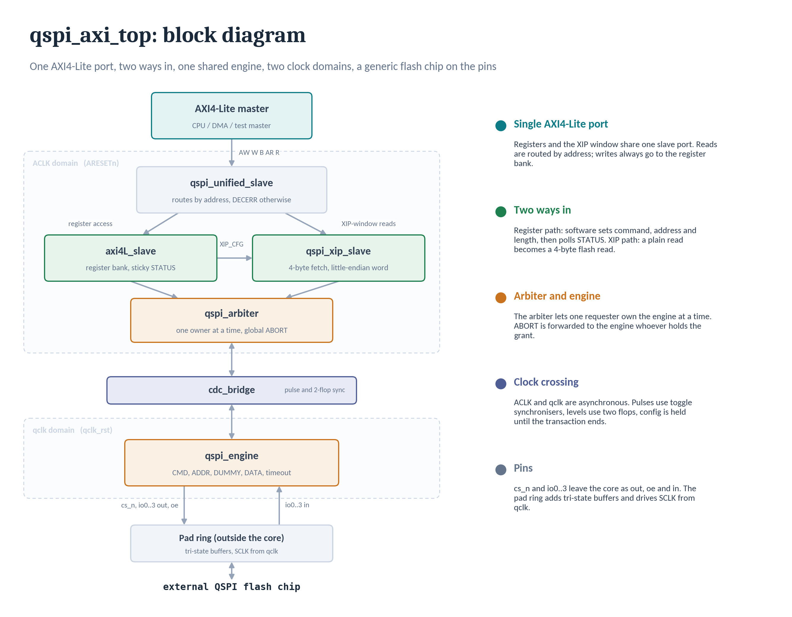

The flash clock (SCLK) is not a port of the core. The core takes `qclk` in and the integrator's pad ring forwards it to the memory.

### 2.2 Modules

| Module | File | Role |
|---|---|---|
| `qspi_axi_top` | `rtl/qspi_axi_top.sv` | Top level. Parameters `TIMEOUT_CYCLES`, `XIP_BASE`, `XIP_SIZE`. Wires everything below together. |
| `qspi_unified_slave` | `rtl/axi/qspi_unified_slave.sv` | Single external AXI4-Lite slave port. Writes always go to the register path (XIP is read-only). Reads are routed by address: XIP window, register offset, or neither (DECERR). |
| `axi4L_slave` | `rtl/axi/axi4L_slave.sv` | Register bank, AW/W/B and AR/R handshake FSMs, sticky STATUS bits, `XIP_CFG` register. |
| `qspi_xip_slave` | `rtl/xip/qspi_xip_slave.sv` | Read-only memory-mapped fetch FSM: address check and translation, one four-byte engine transaction per read, little-endian word assembly, error response. |
| `qspi_arbiter` | `rtl/qspi/qspi_arbiter.sv` | Grants the single engine to the register path or the XIP path. Routes responses back to the owner only. Forwards ABORT globally. |
| `cdc_bridge` | `rtl/cdc/cdc_bridge.sv` | Crosses control, status and data between `ACLK` and `qclk`. Holds TX/RX data. |
| `pulse_sync` | `rtl/cdc/pulse_sync.sv` | Toggle-based pulse synchroniser (three flops plus XOR edge detect). |
| `qspi_engine` | `rtl/qspi/qspi_engine.sv` | The QSPI shift engine and phase FSM. Holds the timeout counter. |
| `qspi_axi_pkg` | `rtl/qspi/qspi_axi_pkg.sv` | Register offsets, bit positions, line-width encodings, AXI FSM enums. |
| `qspi_flash_model` | `emu/qspi_flash_model.sv` | Simulation-only flash model used by the testbenches. Not part of the design. |

## 3. Top-level interface

### 3.1 Parameters

| Parameter | Default | Meaning |
|---|---|---|
| `TIMEOUT_CYCLES` | `20'hFFFFF` | Number of `qclk` cycles of continuous BUSY after which the engine aborts itself and raises ERROR. |
| `XIP_BASE` | `32'h0100_0000` | Start of the XIP address window. |
| `XIP_SIZE` | `32'h0100_0000` | Size of the XIP window (16 MB). The window is `XIP_BASE <= addr < XIP_BASE + XIP_SIZE`. |

### 3.2 Ports

| Group | Signals | Notes |
|---|---|---|
| Clocks / resets | `ACLK`, `ARESETn` (active-low); `qclk`, `qclk_rst` (**active-high**) | Independent, asynchronous clocks. The two reset polarities differ. |
| AXI4-Lite slave | `S_AXI_AW*`, `S_AXI_W*`, `S_AXI_B*`, `S_AXI_AR*`, `S_AXI_R*` (32-bit address and data, 4-bit `WSTRB`) | Single port for both paths. |
| QSPI pins | `cs_n`; `io0..io3` each as `_out`, `_oe`, `_in` | Separate output, output-enable and input per line (the top level does not instantiate tri-state buffers). |

## 4. Clocking, reset and CDC

- `ACLK` is the AXI-side clock. `qclk` drives the QSPI engine and is also the serial clock source. The testbench sets `ACLK` to 10 ns and `qclk` to 20 ns by default (`+qclk_period=` overrides it).
- Every signal between the two domains uses one of the methods below. How each method works is explained in sections 12.3 to 12.5. See waveform 4 for the pulse crossing.

| Signals | Direction | Method |
|---|---|---|
| `start`, `abort` | ACLK to qclk | Toggle pulse synchroniser |
| `done`, `tx_req`, `rx_valid` | qclk to ACLK | Toggle pulse synchroniser |
| `busy`, `error` | qclk to ACLK | Two-flop level synchroniser (faster than the pulse path) |
| `ctrl_cmd`, `addr`, `num_bytes` | ACLK to qclk | None. Quasi-static: written well before START and held until the transaction ends. **Software must not change them while BUSY.** |
| TX and RX data | both | Held in registers inside `cdc_bridge` |

- **Ordering hazard that shaped the design:** the level path (`busy`) is faster than the pulse path (`rx_valid`, `tx_req`, `done`), so `busy` can drop before the last pulse arrives. Section 12.6 explains it; sections 8.1 and 8.2 show where it is handled.

## 5. Register map

The register map is in [register_map.md](./register_map.md): offsets, access types and the bit layouts of CTRL_CMD, STATUS and XIP_CFG. Behaviour such as which accesses return DECERR, is in section 8.5.

## 6. Register-path operation

### 6.1 Software sequence

1. Write `ADDR` and `NUM_BYTES`.
2. For a write transaction, write the first byte to `TX_DATA`.
3. Write `CTRL_CMD` with START set (and `DIR`, widths, dummy count and opcode).
4. Poll `STATUS` until BUSY clears and DONE is set. For reads, read `RX_DATA`; for writes, supply further bytes to `TX_DATA` as TX_READY indicates.
5. Write 1 to `STATUS.DONE` to clear it (optional, since the next START clears it too).

### 6.2 Hardware sequence

1. `axi4L_slave` stores the registers. On a CTRL_CMD write with bit 21 set it pulses `qspi_start` for one `ACLK` cycle.
2. `cdc_bridge` carries the pulse into `qclk`. The configuration (`ctrl_cmd`, `addr`, `num_bytes`) is latched by the engine and frozen for the transaction.
3. The engine sets BUSY and lowers `cs_n`. It then walks four phases in order:
   - **CMD:** opcode on `io0`, single line.
   - **ADDR:** 24 or 32 bits, 1, 2 or 4 bits per `qclk` according to `ADDR_LINES`. Skipped when `CTRL_CMD.NO_ADDR` is set.
   - **DUMMY:** `DUMMY_CYCLES` clocks with the bus turned around.
   - **DATA:** `NUM_BYTES` bytes at 1, 2 or 4 bits per `qclk` according to `DATA_LINES`.
4. Reads: each completed byte pulses `rx_valid` and is captured into `RX_DATA`. Writes: the engine pulses `tx_req` before each new byte. The first byte is pre-loaded at START, because no `tx_req` can precede byte 0.
5. At the end of DATA the engine drops BUSY, raises `cs_n`, and pulses `done`. If `NUM_BYTES` is 0 there is no DATA phase: the transaction ends on the last cycle of the phase before it (for an opcode-only command, after the 8 opcode clocks). `cdc_bridge` returns the events to `ACLK` and `axi4L_slave` updates STATUS.

Phase order is `CMD(00) > ADDR(01) > DUMMY(10) > DATA(11) > CMD(00)`. See waveform 1.

## 7. XIP path operation

1. A read on the AXI port lands in `[XIP_BASE, XIP_BASE + XIP_SIZE)`. `qspi_unified_slave` forwards it to `qspi_xip_slave`.
2. `ARREADY` is asserted whenever the XIP FSM is idle, **regardless of `XIP_ENABLE`**. A disabled or out-of-range request is accepted and then answered with DECERR, because an AXI slave must always respond.
3. The range check uses the live `ARADDR`, not the latched copy, because the latch has not updated yet on the accepting cycle.
4. Flash address = `ARADDR - XIP_BASE`. The engine is started with `DIR = read`, the width, opcode and dummy fields from `XIP_CFG`, and `NUM_BYTES = 4` (one word per transaction).
5. The FSM states are `XIP_IDLE, XIP_REQ, XIP_COLLECT, XIP_RESP, XIP_SETTLE`. `XIP_SETTLE` is a one-cycle gap so that a fast error completion cannot re-accept a lingering `ARVALID` from the master.
6. The four bytes are assembled **little-endian**: the first byte (lowest address) lands in bits [7:0]. See waveform 10.
7. The response is OKAY (`RRESP = 00`) on success, or DECERR (`RRESP = 10`) if XIP is disabled, the address is out of range, or the engine reported an error.

Every XIP read pays the full CMD + ADDR + DUMMY overhead of a new transaction. There is no continuous-read mode (see 9.2).

## 8. Arbitration, abort and error handling

### 8.1 Arbitration

- Grant states: `GNT_NONE`, `GNT_REG`, `GNT_XIP`. If both request on the same cycle, the register path wins.
- Each requester only ever sees `busy`, `done`, `error`, `tx_req` and `rx_valid` while it holds the grant. `rx_data` is passed through ungated: it has no meaning without that requester's own `rx_valid`.
- **Grant release** needs two things: the arbiter must first have seen BUSY go high for this transaction (otherwise the CDC round trip lets it release a grant before the transaction starts), and BUSY must have stayed low for `DRAIN_CYCLES` (= 4) so late `rx_valid` / `tx_req` pulses still reach their owner.
- Because both paths now share one AXI port, two **reads** can never be concurrent. A register-path START (write channels) and an XIP read (read channel) can still arrive together, since AW/W and AR are independent channels.

### 8.2 Abort

- Writing CTRL_CMD bit 23 pulses `abort`. The arbiter forwards it to the engine **unconditionally, regardless of who holds the grant**. A register-path abort can therefore cut short an XIP transaction. This is deliberate: abort is a recovery mechanism, and gating it would leave a hung XIP transaction recoverable only by reset.
- The engine drops BUSY and `cs_n` the same cycle. `done` never pulses on an abort.
- If XIP held the grant, `qspi_xip_slave` leaves `XIP_COLLECT` for `XIP_RESP` after `XIP_DRAIN_CYCLES` (= 6) and answers DECERR. See waveform 9.

### 8.3 Timeout

- The engine counts `qclk` cycles while BUSY. At `TIMEOUT_CYCLES` it behaves as an abort and sets ERROR (sticky, W1C). A legitimate transfer must never reach this limit, so the default is very large. The core testbench overrides it to 1000 so the timeout test is quick while a 256-byte transfer still completes.
- On the XIP side a timeout is reported as DECERR. The register path must still work afterwards.

### 8.4 Sticky-bit rules

- `STATUS.DONE` is sticky because the raw `done` pulse is a single `ACLK` cycle and cannot be polled.
- `DONE` and `ERROR` clear by writing 1 to their own bit only. Clearing one must not disturb the other bits (waveform 7).

### 8.5 AXI response summary

| Situation | Response |
|---|---|
| Any register read at a valid offset | OKAY |
| Register read at an offset that is neither valid nor in the XIP window | DECERR |
| Register write | OKAY. The write channel always returns OKAY, and unmapped write offsets are ignored |
| XIP read, success | OKAY, 32-bit little-endian word |
| XIP read with `XIP_ENABLE = 0`, out of range, timeout or abort | DECERR |

## 9. Known limitations

### 9.1 No real flow control

`TX_READY` / `RX_READY` only tell software that a byte needs servicing. The engine does **not** stall for it: the byte stream runs at full `qclk` speed regardless. True backpressure would need the engine's counters paused mid-transfer, which is only safe if `qclk` is gated before reaching the SCLK pin. That is a top-level or board matter outside these RTL files and was never confirmed.

### 9.2 No continuous-read mode for XIP

There is no mode-bits phase, so every XIP access repeats the full command and address. This is correct for occasional memory-mapped reads but likely too slow to execute code from.

## 10. Verification

### 10.1 Environment

- Testbenches: `sim/tb_qspi_axi_top.sv` (core, register path, 25 tests) and `sim/tb_xip_qspi_axi_top.sv` (XIP, 11 tests). Both are self-checking and print `[PASS]` / `[FAIL]` lines and a `SUMMARY`.
- Flash model: `emu/qspi_flash_model.sv`. Its memory is `mem[i] = i`, so any wrong byte is identifiable from its value, and it records bytes written to it. It decodes the opcode itself, so it is independent of the DUT. Opcode `0xEB` there is a simplified, test-fixture-only quad variant.
- Simulation time unit is **picoseconds**.
- Both suites pass on Icarus Verilog and on Verilator 5.032. The commands are in the README and use `sim/filelist.f`, which lists every RTL file plus the flash model (it must include `rtl/axi/qspi_unified_slave.sv`, which the top level instantiates).

### 10.2 Test inventory

**Core suite (`tb_qspi_axi_top.sv`)**

| Area | Tests |
|---|---|
| Read widths | `read_single_1byte`, `read_dual_1byte`, `read_quad_1byte`, `read_quad_3byte_lastbyte` |
| Address / dummy options | `read_32bit_addr`, `read_dummy_zero`, `dual_line_address_phase`, `quad_line_address_phase`, `mixed_quad_addr_single_data` |
| Write direction | `write_single_1byte`, `write_quad_1byte` |
| Commands without an address | `noaddr_rdid`, `noaddr_wren_8_clocks`, `noaddr_wren_sets_wel`, `noaddr_wrsr_sets_qe`, `noaddr_wrsr_needs_wren`, `numbytes_zero_ends_after_address` |
| Control and sequencing | `back_to_back_txns`, `start_while_busy_ignored`, `numbytes_255_boundary`, `numbytes_256_truncation` |
| Status behaviour | `sticky_done_bit`, `tx_rx_ready_visibility` |
| Abort and timeout | `abort_midtransaction`, `timeout_safety_net` |

**XIP suite (`tb_xip_qspi_axi_top.sv`)**

| Area | Tests |
|---|---|
| Basic fetch | `xip_baseline_fetch`, `xip_dual_line_data_fetch`, `xip_quad_line_data_fetch`, `xip_back_to_back_fetches` |
| Rejection paths | `xip_disabled_reject`, `xip_out_of_range` |
| Shared port | `shared_port_register_then_xip_read` |
| Abort / timeout / recovery | `abort_cuts_short_xip_transaction`, `xip_timeout_reports_error`, `register_path_recovers_after_xip_timeout` |
| Robustness | `xip_cfg_write_mid_flight_does_not_corrupt` |

### 10.3 Bugs found and fixed during bring-up

These are the corner cases that matter most, because each one was a real failure mode.

**Engine and CDC (`qspi_engine.sv`, `cdc_bridge.sv`)**
- RX lost the first nibble/bit of every byte: `rx_valid` raced the final shift-register update. Fixed by building `rx_valid` from a one-cycle-delayed `byte_boundary`.
- Single and dual-line reads were corrupted by sampling all four IO lines regardless of the configured width.
- Write direction lost byte 0: TX data was never primed before the first byte-load point.
- TX shift register loaded one cycle late, corrupting every write (same non-blocking-assignment timing class as the RX bug).
- `NUM_BYTES` silently wrapped at 256 (only `num_bytes[7:0]` was used).

**Register and architecture changes**
- `STATUS.DONE` changed from a raw pulse to a sticky, W1C bit.
- Added global ABORT (CTRL_CMD bit 23).
- Added the timeout safety net and the ERROR bit.
- Added TX_READY / RX_READY.
- Verified dual and quad **address** phases for the first time, and the mixed combinations (quad address with single data).
- Added the memory-mapped XIP read path, with arbitration.

**XIP and arbiter (`qspi_arbiter.sv`, `qspi_xip_slave.sv`)**
- `rx_data` was wrongly gated by grant, breaking register-path reads after a transaction.
- Grant was released before the slower `rx_valid` / `tx_req` synchronisers delivered. Fixed with the drain margin.
- `ARREADY` was gated on `XIP_ENABLE`: a disabled XIP could hang a master forever.
- `XIP_CFG` enable bit overlapped the opcode field.
- `x_rx_data` was sampled one cycle early relative to when `cdc_bridge` settles it.
- Byte assembly was big-endian. Corrected to little-endian.
- A stale error from the previous transaction was visible to the next for a few cycles (CDC lag). Fixed by requiring BUSY to be seen high first for the current transaction.
- After abort became global, a normal completion could be misreported as an abort, because BUSY can drop before the last `rx_valid` arrives. Fixed with `XIP_DRAIN_CYCLES`.

---

## 11. Glossary

| Term | Meaning |
|---|---|
| AXI4-Lite | Simple memory-mapped bus: single 32-bit transfers, no bursts, five independent channels |
| AW / W / B | Write address, write data and write response channels |
| AR / R | Read address and read data channels |
| VALID / READY | Handshake pair. A transfer happens on the clock edge where both are high |
| OKAY / DECERR | AXI responses: success, and "no slave at this address" (also used here for rejected or failed XIP reads) |
| WSTRB | Per-byte write mask on the W channel |
| SPI | Serial bus with SCLK, MOSI, MISO and CS#. Full duplex, one bit per clock |
| QSPI | SPI extended to four bidirectional lines (`io0` to `io3`), so four bits per clock. Half duplex |
| CS# (`cs_n`) | Chip select, active low. Low for the whole transaction |
| Opcode | The first byte of a flash transaction, naming the operation (for example `0x6B` quad read) |
| Dummy cycles | Idle clocks between address and data, giving the bus time to change direction |
| Phase | One stage of a transaction: CMD, ADDR, DUMMY or DATA |
| XIP | Execute-in-place. Flash is mapped into the address space, so a normal read fetches from it with no register steps |
| Engine | The block that shifts bits on the QSPI pins (`qspi_engine`) |
| Arbiter | Decides whether the register path or XIP owns the engine |
| Grant | The arbiter's current owner: none, register path or XIP |
| ACLK / qclk | The AXI-side clock and the QSPI-side clock. Asynchronous to each other |
| CDC | Clock domain crossing. Moving a signal from one clock to another |
| Metastability | A flip-flop sampling a changing input and settling to an unpredictable value after an unbounded time |
| 2-flop synchroniser | Two flip-flops in series on the receiving clock. Used for level signals |
| Toggle pulse synchroniser | Pulse is turned into a toggle, synchronised, then turned back into a pulse. Used for one-cycle events |
| Quasi-static | A value that is written well before it is used and not changed while in use, so it is not synchronised |
| Sticky bit | A status bit that stays set until software clears it |
| W1C | Write-1-to-clear. Writing 1 to the bit clears it; writing 0 does nothing |
| Drain margin | A few cycles of waiting so late synchronised pulses are not lost when a grant is released |
| Little-endian | The lowest-address byte goes in the lowest byte of the word |
| Timeout safety net | The engine aborts itself and sets ERROR if BUSY lasts too long |

## 12. Core concepts

### 12.1 Why there are two clocks

The AXI bus and the flash do not need to run at the same speed. The flash has its own maximum clock, so the QSPI engine gets its own clock (`qclk`) and the AXI side keeps `ACLK`. The price is that every signal between the two sides has to be crossed safely.

### 12.2 Metastability

A flip-flop needs its input steady for a short time around the clock edge. A signal from another clock can change inside that window. The flip-flop then hovers between 0 and 1 for an unpredictable time before it settles, and the value it settles to is not predictable either. This is a physical effect, not a simulation artefact, so a signal must never go straight from one clock domain into logic on another.

### 12.3 Level signals: two-flop synchroniser

For a signal that only needs an eventually-correct value (`busy`, `error`), pass it through two flip-flops on the receiving clock. The first may go metastable; the second gives it a full clock period to settle.

### 12.4 Pulse signals: toggle synchroniser

A one-cycle pulse on a fast clock can fall between two edges of a slow clock and be missed entirely, so a plain two-flop chain is not enough. `pulse_sync` handles it in three steps:

1. The source flips a toggle flop on every pulse. A toggle is a level, so it cannot be missed.
2. The toggle goes through three flops on the receiving clock.
3. An XOR of the last two flops is high for exactly one cycle after each flip, which gives back a clean pulse.

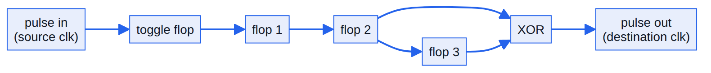

### 12.5 Multi-bit values: quasi-static

`ctrl_cmd`, `addr` and `num_bytes` are several bits wide, and synchronising each bit separately could give a mix of old and new bits. They are written before START and held until the transaction ends, so they are passed across unsynchronised. Section 4 states the rule that follows from this.

### 12.6 Why pulses and levels can disagree

A level takes two flops to cross; a pulse takes three plus the XOR. So `busy` can fall before the last `rx_valid` or `done` arrives. This is the reason for the drain margins described in sections 8.1 and 8.2.

### 12.7 QSPI phases

The phase order and widths are in section 6.2. Two points explain why they look the way they do:

- **CMD is always single-line.** A quad-capable flash still recognises the same opcode a single-line-only part would.
- **DUMMY exists for bus turnaround.** The master drives the address and the flash drives read data. Switching with zero gap risks both driving the same wires at once, so real datasheets specify a fixed dummy count per opcode.

### 12.8 XIP in one paragraph

A CPU fetch cannot run software between "decide to read" and "read happens", so the read opcode, widths and dummy count are fixed ahead of time in `XIP_CFG`. A normal AXI read in the XIP window then becomes a four-byte flash read, assembled little-endian into one word. Section 7 covers the rejection behaviour.

## 13. References

| Source | Informs |
|---|---|
| ARM, [AXI Protocol Overview](https://developer.arm.com/documentation/102202/0300/AXI-protocol-overview) | AXI4-Lite channels and VALID/READY handshake |
| ARM, [AMBA AXI and ACE Protocol Specification](https://developer.arm.com/documentation/ihi0022/latest) (IHI 0022) | The full formal AXI specification |
| Winbond, [W25Q128JV datasheet](https://www.winbond.com/resource-files/W25Q128JV%20RevH%2003102021%20Plus.pdf) | QSPI phase structure, opcode `0x6B`, dummy-cycle counts used in the flash model |
| D. Gisselquist, [Formally Verifying a QSPI Flash Controller](https://zipcpu.com/blog/2019/03/27/qflexpress.html) (ZipCPU) | CMD/ADDR/DUMMY/DATA structure and bus turnaround; mode bits and continuous read, which this design does not implement |
| C. Cummings, [Clock Domain Crossing Design and Verification Techniques Using SystemVerilog](http://www.sunburst-design.com/papers/CummingsSNUG2008Boston_CDC.pdf) (SNUG Boston 2008) | Two-flop and toggle-based pulse synchronisers |

---

## Appendix A. Waveform evidence

Captures from GTKWave on Verilator 5.032 runs, with signals added by full hierarchical path (for example `tb_qspi_axi_top.u_dut.u_qspi_engine.phase`). Images are in `images_waveforms/`. Captures 1-7 come from the core suite, 8-10 from the XIP suite.

**1. Basic read, phase by phase.** `read_quad_1byte`, about 90-1210 ps. Signals: `ACLK`, `qclk`, `qspi_start`, `phase`, `bit_cnt`, `cs_n`, `io0_out`, `io0_oe`, `busy_r`.
`phase` walks CMD, ADDR, DUMMY, DATA, CMD with the expected durations. `cs_n` and `busy_r` move together, `io0_oe` is only high during the transaction, and `io0_out` shows the opcode shifting out.
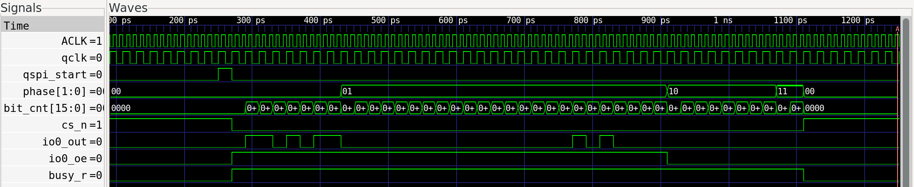

**2. RX-timing fix.** `read_quad_1byte` at address 0x50 (chosen because its high nibble is non-zero), zoomed on the DATA tail. Signals: `byte_boundary`, `byte_boundary_d1`, `in_byte`, `qspi_rx_valid`.
When `byte_boundary` pulses, `in_byte` still reads `05`. One `qclk` later, at `byte_boundary_d1`, it reads the correct `50`. `qspi_rx_valid` is built from `byte_boundary_d1`.
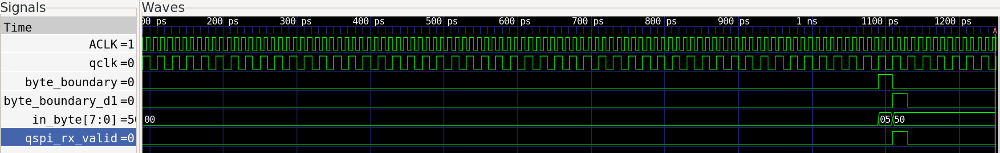

**3. TX priming fix.** `write_single_1byte`, about 3630-4750 ps. Signals: `axi_start`, `tx_data_hold`, `qspi_tx_data`, `tx_shift_byte`, `io0_out`.
`tx_data_hold` takes `AA` right after `axi_start`, without waiting for a `tx_req`. `tx_shift_byte` shifts `AA, 54, A8, 50, A0, 40, 80, 00` and `io0_out` produces 1,0,1,0,1,0,1,0 from the first bit.
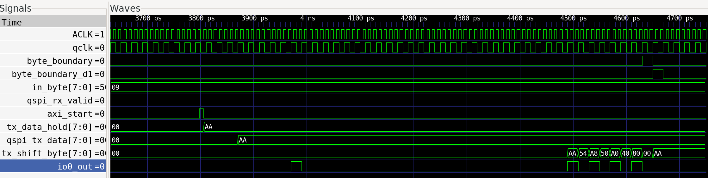

**4. CDC pulse crossing (ACLK to qclk).** About 90-250 ps. Signals: `axi_start`, `u_start_sync.toggle_src`, `sync_ff1/2/3`, `qspi_start`.
`toggle_src` flips with `axi_start`. The three sync flops follow one `qclk` apart. `qspi_start` appears in the one cycle where `sync_ff2` and `sync_ff3` differ.
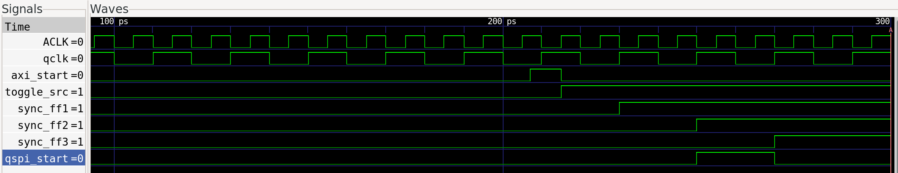

**5. Abort mid-transaction.** `abort_midtransaction`, about 22140-22570 ps. Signals: `phase`, `bit_cnt`, `qspi_abort`, `busy_r`, `cs_n`, `qspi_done`.
`qspi_abort` fires while `bit_cnt` is mid-count in the CMD phase. `busy_r` and `cs_n` change the same cycle, and `qspi_done` stays low throughout.
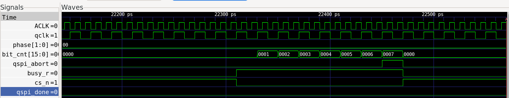

**6. Timeout safety net.** `timeout_safety_net` (captured when the testbench override was 200; it is now 1000 with a longer transfer, same behaviour), about 22560-26945 ps. Signals: `timeout_cnt`, `timeout_hit`, `error_r`, `busy_r`.
`busy_r` stays high for about 4.3 us (roughly 215 `qclk` cycles at 20 ns) while `timeout_cnt` counts. The zoomed capture shows the trigger: `timeout_hit` for exactly one cycle at the threshold, `error_r` set on the next edge, and `busy_r` dropping on that edge.
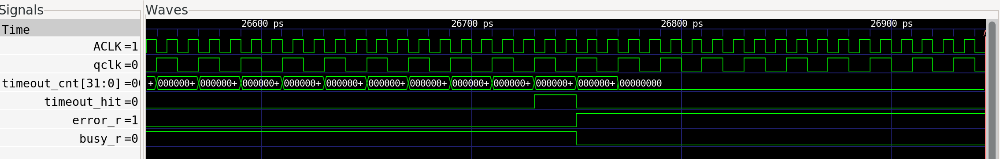

**7. Sticky DONE.** `sticky_done_bit`, about 16800-18020 ps. Signals: `qspi_done`, `done_latched`, `AXI_RDATA`, `status_w1c_done`.
`qspi_done` is a brief pulse while `done_latched` stays set after it. STATUS reads `0x0E`, then `0x0C` after the W1C: only bit 1 cleared, TX_READY and RX_READY undisturbed.
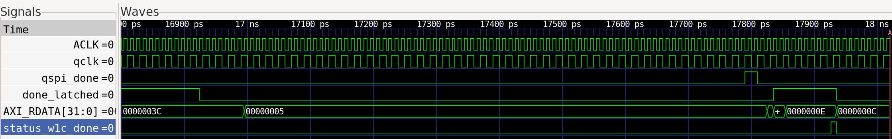

**8. XIP grant.** XIP suite, about 2-3 ns. Signals: `grant`, `a_start`, `x_start`, `axi_start`.
The capture shows `x_start` and `axi_start` pulsing together with `a_start` low, `grant` going from `00` to `10` (`GNT_XIP`) and returning to `00` once the transaction and drain margin finish. **This is an XIP-only grant.** It does not show the register-path-versus-XIP tie-break that an earlier version of this document described, and that same-cycle collision test no longer exists. Replace this capture if a collision test is added.
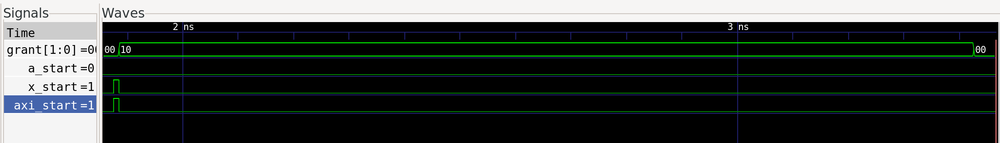

**9. Global abort during XIP.** `abort_cuts_short_xip_transaction`, about 3465-3845 ps. Signals: `grant`, `qspi_abort`, `axi_abort`, `state`, `fetch_error`, `XIP_RRESP`.
`grant` is `10` (XIP) when `qspi_abort` pulses, and `axi_abort` pulses in the same cycle. About 130 ps later, after the drain margin, `state` moves `010` to `011` to `100` to `000`, `fetch_error` sets, and `XIP_RRESP` reads `10` (DECERR).
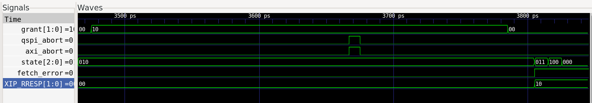

**10. Little-endian assembly.** `xip_baseline_fetch`, about 145-1805 ps. Signals: `x_rx_valid_d1`, `byte_count`, `assemble_reg`, `XIP_RDATA`.
Each `x_rx_valid_d1` pulse places a byte at its own position. `assemble_reg` builds up as `…10`, `…1110`, `…121110`, then `13121110`, so the lowest-address byte ends in the low byte of the word.
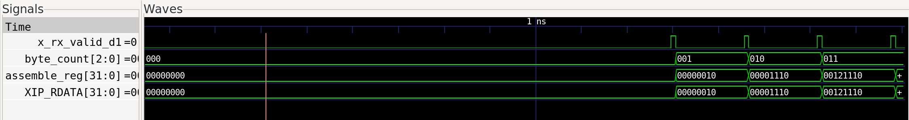
